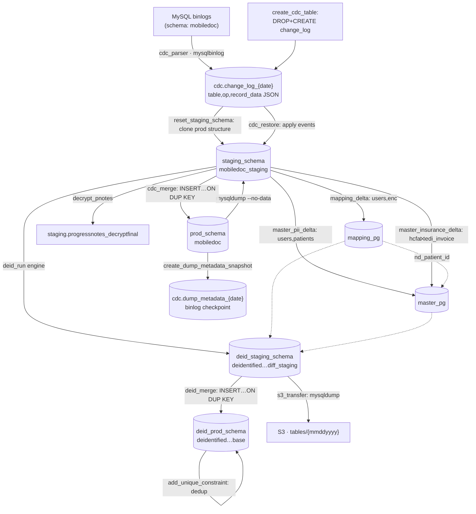

# dent (CDC automation) — Data Flow

- DAG: `dags/dent/cdc_automation_dag.py` (`dag_id = cdc_automation`)
- Engine: **MySQL end-to-end** (source *and* target). dent ignores `SOURCE_DB_TYPE`.
- Change capture: **MySQL binary-log CDC** (`mysqlbinlog`), not restore + diff-merge.
- Task construction: **inline** `PythonOperator`s calling scripts in
  `CDC/MySQL/` (under `DEID_REPO_DIR` = `…/deidentification_v2`); the deid run and s3 step reach
  into `Airflow/scripts/`. Does **not** import `shared.tasks`.

## Schema inventory (MySQL, one server `localhost:3306`)

| Role | Schema/DB | How resolved | Effective (scheduled) |
|---|---|---|---|
| PROD (live) | `prod_schema` | `PROD_DB_NAME` / param | **`mobiledoc`** |
| CDC log | `cdc_schema` | `DB_CDC_SCHEMA` (`cdc`) | `cdc` → `change_log_{mmddyyyy}`, `dump_metadata_{date}` |
| STAGING | `staging_schema` | `STAGING_DB_NAME` / param | **`mobiledoc_staging`** |
| MAPPING | `mapping_schema` | `MAPPING_DB_NAME` | `mapping_pg` |
| MASTER | `master_schema` | `MASTER_DB_NAME` | `master_pg` |
| DEID STAGING | `deid_staging_schema` | `DEID_STAGING_NAME` | `deidentified_mobiledoc_diff_staging` |
| DEID PROD | `deid_prod_schema` | `DEID_BASE_NAME` | `deidentified_mobiledoc_base` |

Source tables consumed: `users`, `enc`, `patients`, `structdemographics`, `structdatadetail`,
`progressnotes`, `hcfa`, `edi_invoice` (the staging "floor" tables).

## Flow

## Stage-by-stage (execution order)

| # | Task | READ → WRITE / DELETE |
|---|---|---|
| 1 | preprocessing | No DB (logging/placeholder). |
| 2 | create_cdc_table | **DROP + CREATE** empty `cdc.change_log_{mmddyyyy}` (mysql CLI). |
| 3 | cdc_parser | READ MySQL **binlogs** (`mysqlbinlog`, schema `mobiledoc`) → WRITE `cdc.change_log_{date}` `(table, op, record_data JSON, binlog_file, pos)` [INSERT IGNORE]. On retry: `DELETE FROM change_log WHERE binlog_file IN (…)`. |
| 4 | add_nd_audit_columns | **Skipped by default** (`skip_init_nd_columns=True`). When on: ALTER `nd_*` audit columns onto prod tables in the change_log. |
| 5 | reset_staging_schema | **DROP SCHEMA** `staging_schema` then recreate; clone prod **structure** (changed tables ∪ floor tables) via `mysqldump --no-data`. |
| 6 | cdc_restore | READ `cdc.change_log` events + prod/staging column metadata → WRITE reconstructed INSERT/UPDATE rows into `staging_schema` (binlog lower-bound from last `dump_metadata`). Adds `nd_auto_increment_id` + audit cols. |
| 7 | check_continue | ShortCircuit if `stop_after_cdc_restore`. |
| 8 | decrypt_pnotes | READ `staging.progressnotes` → Blowfish-decrypt → WRITE `staging.progressnotes_decryptfinal` [DROP dest + CREATE + INSERT]. |
| 9 | cdc_merge | READ all non-empty `staging_schema` tables → WRITE `prod_schema` [INSERT … ON DUPLICATE KEY UPDATE]. Ensures CDC audit cols on prod. |
| 10 | mapping_delta | READ `staging.users` (UserType=3), `staging.enc` (+ exclusions from `structdemographics`/`structdatadetail`) + `mapping_pg` existing → WRITE `mapping_pg.patient_mapping_table` + `encounter_mapping_table` [insert/upsert]. `nd_patient_id = MAX+1`. |
| 11 | master_pii_delta | READ `staging.users` + `staging.patients` + `mapping_pg` → WRITE `master_pg.pii_data_table` [INSERT … ON DUP KEY UPDATE, COALESCE]. |
| 12 | master_insurance_delta | READ `staging.hcfa` **INNER JOIN** `staging.edi_invoice` + `mapping_pg` → WRITE `master_pg.master_insurance_table` [INSERT … ON DUP KEY UPDATE], one row per `nd_patient_id`. |
| 13 | reset_deid_staging_schema | **DROP SCHEMA** `deid_staging_schema` then CREATE empty. |
| 14 | deid_run | `Airflow/scripts/manual_deidentification_run_v2.py` with `scripts/ecw/ecw_config_incremental.yaml`; substitutes `progressnotes → progressnotes_decryptfinal`. READ source/staging + `mapping_pg`/`master_pg` → WRITE de-identified rows into `deid_staging_schema`. |
| 15 | deid_merge | Reuses `CDC/MySQL/cdc_merge.py` `--staging deid_staging --prod deid_prod`. READ `deid_staging_schema` → WRITE `deid_prod_schema` [upsert]. |
| 16 | s3_transfer | `Airflow/scripts/s3_transfer.py`. Dump `deid_staging_schema` tables → upload to S3 `tables/{mmddyyyy}`. |
| 17 | create_dump_metadata_snapshot | WRITE `cdc.dump_metadata_{run_date}` — the binlog lower-bound checkpoint the next run's `cdc_restore` reads. (`--schema_name mobiledoc`, hardcoded.) |
| 18 | add_unique_constraint | Dedup rows + add UNIQUE on `nd_auto_increment_id` in `deid_prod_schema` (may DELETE duplicate rows during dedup). |

## Where data is deleted (dent)
- **`create_cdc_table`** — DROP the day's `change_log`.
- **`reset_staging_schema`** / **`reset_deid_staging_schema`** — DROP SCHEMA then rebuild.
- **`decrypt_pnotes`** — DROP+recreate `_decryptfinal`.
- **`cdc_parser`** retry — DELETE partial change_log rows for reprocessed binlog files.
- **`add_unique_constraint`** — deletes duplicate rows during dedup.
- **No terminal `delete_original_diffmerged`** — dent has no diff-merged accumulator; cleanup is via the schema drops above.

## How dent differs from eCW
- **Binlog CDC** (change_log → cdc_restore → staging → cdc_merge → prod) instead of restore + diff-merge.
- **MySQL only** on both sides; `SOURCE_DB_TYPE` irrelevant.
- **Inline** `PythonOperator`s calling `CDC/MySQL/*.py`; no `shared.tasks`.
- **No** `validate_diff_merge` / `validate_mapping` / `check_deid_status` / `delete_original_diffmerged`;
  instead a `check_continue` short-circuit + a `create_dump_metadata_snapshot` binlog checkpoint.
- Shares the conceptual back half (mapping / pii / insurance / decrypt / deid / merge / s3) and even
  points `deid_run` at the eCW config `scripts/ecw/ecw_config_incremental.yaml`.
