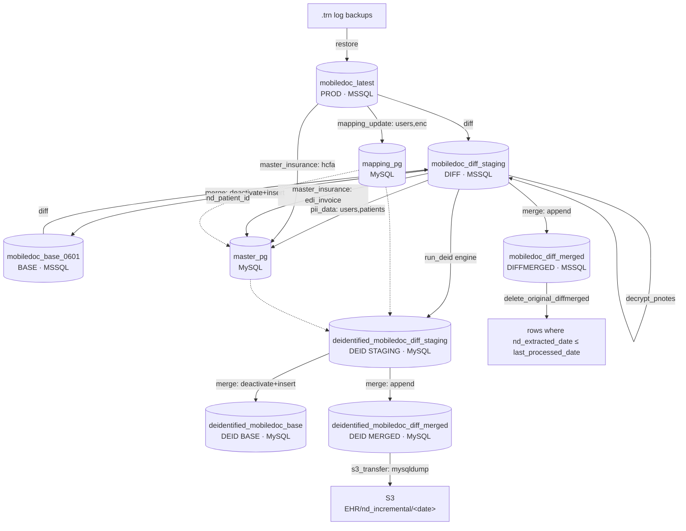
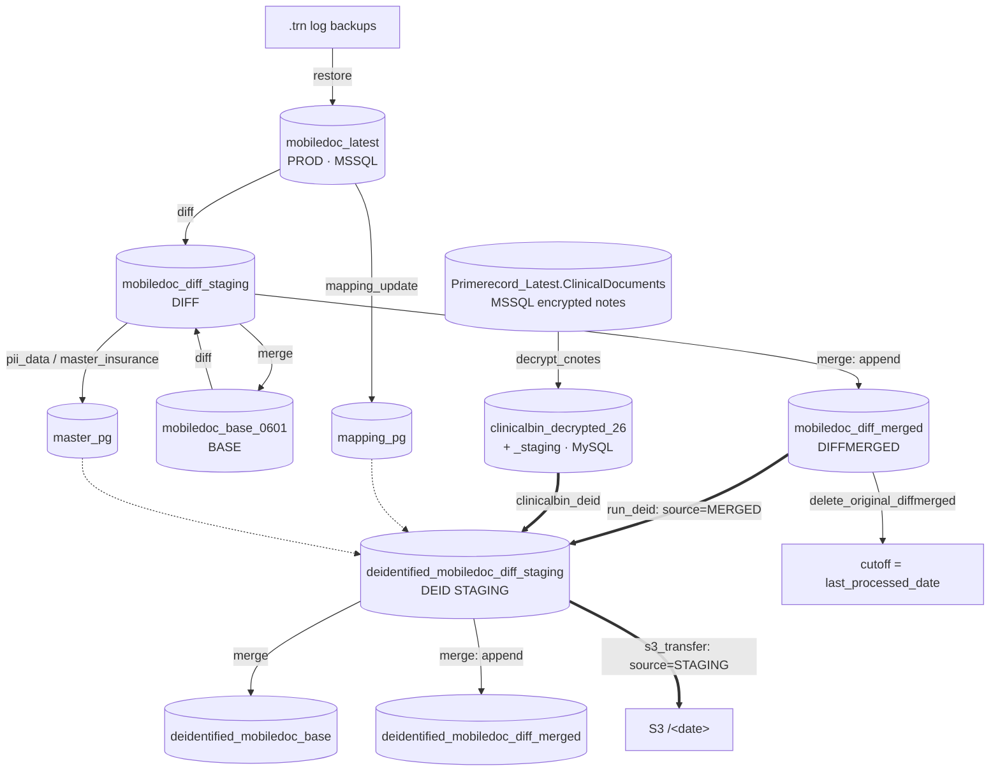

# eCW + Greenway — Data Flow

eCW and Greenway are grouped because both DAGs are built from the **shared task factories**
in `dags/shared/tasks.py` (`make_mapping_update_v5`, `make_pii_data`, `make_master_insurance`,
`task_run_diff_merge`, `task_run_deid`, `task_check_deid_status`, `task_merge_deid_data`,
`task_delete_diffmerged`, `task_s3_transfer`, …). They share the same DB naming and the same
back-half. Greenway adds two stages and de-identifies a different source DB — called out
throughout.

- eCW DAG: `dags/ecw/ecw_pipeline_dag.py`
- Greenway DAG: `dags/greenway/greenway_pipeline_dag.py`
- Source engine: **MSSQL** (`SOURCE_DB_TYPE=mssql`); de-id side: **MySQL**.

## Database inventory

| Role | DB name | Engine | Used by |
|---|---|---|---|
| BASE | `mobiledoc_base_0601` | MSSQL | diff-merge |
| PROD | `mobiledoc_latest` | MSSQL | diff-merge (new side), mapping/insurance FK joins |
| DIFF | `mobiledoc_diff_staging` | MSSQL | diff output; **eCW deid source**; pii/master delta source (both) |
| DIFFMERGED | `mobiledoc_diff_merged` | MSSQL | merge accumulator; **Greenway deid source**; delete target |
| MAPPING | `mapping_pg` | MySQL | `patient_mapping_table`, `encounter_mapping_table` |
| MASTER | `master_pg` | MySQL | `pii_data_table`, `master_insurance_table` |
| DEID STAGING | `deidentified_mobiledoc_diff_staging` | MySQL | deid output; **Greenway S3 source** |
| DEID BASE | `deidentified_mobiledoc_base` | MySQL | merge target |
| DEID MERGED | `deidentified_mobiledoc_diff_merged` | MySQL | merge accumulator; **eCW S3 source** |
| STATE/FAILED | eCW: MySQL `deid_state`/`deid_failed` · Greenway: SQLite `state.db`/`failed_rows.db` | — | deid engine |

## eCW flow

## Greenway flow (differences highlighted)

## Stage-by-stage (execution order)

`G+` marks a Greenway-only stage; the "Greenway delta" column notes per-stage differences.

| # | Task | READ → WRITE / DELETE | Greenway delta |
|---|---|---|---|
| 1 | check_db_availability | Probe MSSQL DB online/session state. No R/W. Skipped if `skip_restore`. | same |
| 2 | restore | READ `.trn` logs → WRITE (RESTORE LOG) into MSSQL source DBs. | same |
| G+ | **decrypt_cnotes** | — | READ MSSQL `Primerecord_Latest.ClinicalDocuments` → WRITE MySQL `clinicalbin_decrypted_26`, then TRUNCATE+INSERT delta into `clinicalbin_decrypted_staging`. |
| 3 | run_diff_merge | READ BASE vs PROD → WRITE changed rows to DIFF; then READ DIFF+BASE keys → WRITE BASE (deactivate `nd_ActiveFlag='N'` + insert) and append to DIFFMERGED. No delete. | same |
| 4 | validate_diff_merge | READ JSON state (summary); raises on failures. No DB. | same |
| 5 | check_continue | ShortCircuit if `stop_after_diff_merge`. | same |
| 6a | mapping_update (v5, config-only) | READ **PROD `mobiledoc_latest`** (`users WHERE UserType=3`, `enc`) via `MAPPING_SOURCE_*` → WRITE `mapping_pg.patient_mapping_table` + `encounter_mapping_table` (insert / flag Y-N). Writes compat state file. | reads greenway `Patient`/`Visit` tables via `sql/greenway/*.sql`; same dest |
| 6b | pii_data | READ **DIFF** (`users`,`patients`) + `mapping_pg` → WRITE `master_pg.pii_data_table` (upsert on `uq_nd_patient_id`, COALESCE). Graceful-skip if source table absent. | reads `Patient/Person/Address/PersonEmployers/Employers` |
| 6c | master_insurance | READ **PROD** `hcfa` ⨝ **DIFF** `edi_invoice` + `mapping_pg` → **DELETE per `nd_patient_id`** in `master_pg.master_insurance_table` then re-insert. | reads `Patient/InsuranceCoverage/InsurancePlan/InsuranceProviders` |
| 6d | **decrypt_pnotes** (eCW) | READ **DIFF** `progressnotes` → WRITE **DIFF** `progressnotes_decryptfinal` (drop+recreate). Skipped if not in `diff_merge_tables_csv`; graceful-skip if absent. | Greenway has **no** decrypt_pnotes (uses decrypt_cnotes instead) |
| 7 | validate_mapping | READ 3 JSON state files; fails if missing/false/stale. | same |
| G+ | **clinicalbin_deid** | — | Second deid run over MySQL `clinicalbin_decrypted_staging` (`greenway_config_clinicalbin.yaml`, own `config_key`/SQLite state) → WRITE `deidentified_mobiledoc_diff_staging`. |
| 8 | init_deid_state | Reset per-table JSON `deidentification` block (today, `is_merged/is_deleted=False`). | same |
| 9 | run_deid | **eCW: READ DIFF `mobiledoc_diff_staging`** → WRITE `deidentified_mobiledoc_diff_staging`; state→`deid_state`, fails→`deid_failed` (MySQL). | **Greenway: READ MERGED `mobiledoc_diff_merged`** (`join_db=PROD`); state/fails = **SQLite** |
| 10 | check_deid_status | READ state DB + row counts (source vs dest) + failed count → WRITE JSON state (`success` iff `source == dest + failed`). Runs under `sys.executable`. | same (reads SQLite state) |
| 11a | merge_deid_data | READ DEID STAGING + DEID BASE keys → WRITE DEID BASE (deactivate+insert) + append DEID MERGED. Gated on `success` & not `is_merged`. | same |
| 11b | s3_transfer | **eCW: dump `deidentified_mobiledoc_diff_merged`** → S3. | **Greenway: dump `deidentified_mobiledoc_diff_staging`** → S3 |
| 12 | delete_original_diffmerged | DELETE from MSSQL `mobiledoc_diff_merged.<table>` `WHERE nd_extracted_date ≤ last_processed_date`. Gated on `success` & `is_merged` & not `is_deleted`. | same |

## Where data is deleted (eCW/Greenway)
- **master_insurance** — per-patient delete+reinsert refresh.
- **decrypt** — drop+recreate the `_decryptfinal` (eCW) / clinicalbin staging (Greenway).
- **delete_original_diffmerged** — trims the MSSQL DIFFMERGED accumulator of already-merged rows.
- All other "updates" are SCD-2 logical deactivation (`nd_ActiveFlag='N'`).

## Greenway-only summary
1. **`decrypt_cnotes`** — decrypts MSSQL clinical notes into MySQL `clinicalbin_decrypted_*`.
2. **`clinicalbin_deid`** — a second, independent deid run over those decrypted notes (separate
   `config_key` + SQLite state) writing into the same `deidentified_mobiledoc_diff_staging`.
3. **Deid source = MERGED** (`mobiledoc_diff_merged`), not the DIFF staging.
4. **State/failed = SQLite** file paths (no MySQL `*_db_url`).
5. **S3 source = DEID STAGING**, not DEID MERGED.
6. Both `clinicalbin_deid` and `check_deid_status` must finish before merge/S3.
