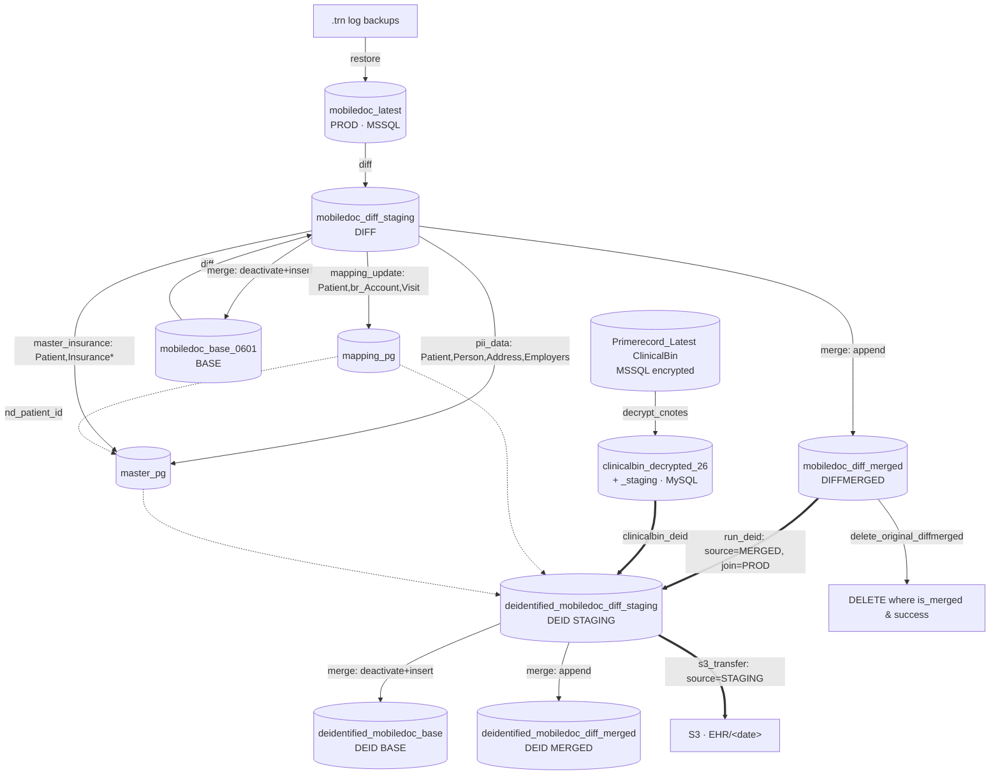

# MIND — Data Flow

- DAG: `dags/mind/mind_pipeline_dag.py` (`dag_id = mind_pipeline`)
- Source engine: **MSSQL** (`SOURCE_DB_TYPE=mssql`); de-id side: **MySQL**.
- **All task callables are defined inline** in the DAG file (lines ~254-598). MIND does
  **not** import the `shared.tasks` factories that eCW/Greenway use — so changes to
  `shared/tasks.py` do **not** affect MIND; its scripts live in `scripts/mind/`.
- Interpreter: every task runs under `DEID_PYTHON` (new_deid) **except `check_deid_status`**,
  which runs under `sys.executable` (air_env, has `pymssql` for the v3 status check).

## Database inventory

| Role | DB name | Engine | Notes |
|---|---|---|---|
| BASE | `mobiledoc_base_0601` | MSSQL | diff old-side |
| PROD | `mobiledoc_latest` | MSSQL | diff new-side + deid `join_db` |
| DIFF | `mobiledoc_diff_staging` | MSSQL | diff output; mapping/pii/insurance delta source |
| DIFFMERGED | `mobiledoc_diff_merged` | MSSQL | merge accumulator; **deid source**; delete target |
| MAPPING | `mapping_pg` | MySQL | `patient_mapping_table`, `encounter_mapping_table` |
| MASTER | `master_pg` | MySQL | `pii_data_table`, `master_insurance_table` |
| DEID STAGING | `deidentified_mobiledoc_diff_staging` | MySQL | deid output + **S3 source** |
| DEID BASE | `deidentified_mobiledoc_base` | MySQL | merge target |
| DEID MERGED | `deidentified_mobiledoc_diff_merged` | MySQL | merge accumulator |
| Clinicalbin | `clinicalbin_decrypted_26`, `clinicalbin_decrypted_staging`, `clinicalbin_decrypt_run_log` | MySQL | decrypted notes + delta |
| STATE/FAILED | `${LOG_DIR}/state.db`, `${LOG_DIR}/failed_rows.db` | SQLite | deid engine |

## Flow

## Stage-by-stage (execution order)

| # | Task | READ → WRITE / DELETE | Interp |
|---|---|---|---|
| 1 | check_db_availability | Probe MSSQL DB online/session state. No R/W. | DEID_PYTHON |
| 2 | restore | READ `.trn` logs → RESTORE into MSSQL source DBs. Gated by `skip_restore`. | DEID_PYTHON |
| 3 | decrypt_cnotes | READ MSSQL ClinicalBin (`CNOTES_SOURCE_CONN`, linked `Primerecord_Latest`) → WRITE MySQL `clinicalbin_decrypted_26` [INSERT]; TRUNCATE+INSERT delta (`nd_auto_increment_id > last`) into `clinicalbin_decrypted_staging`; log to `clinicalbin_decrypt_run_log`. | DEID_PYTHON |
| 4 | run_diff_merge | READ BASE + PROD → WRITE DIFF; then READ BASE+DIFF → WRITE/accumulate DIFFMERGED [upsert]. | DEID_PYTHON |
| 5 | validate_diff_merge | `--mode summary`, parse JSON counts. No DB write. | DEID_PYTHON |
| 6 | check_continue | ShortCircuit if `stop_after_diff_merge`. | DEID_PYTHON |
| 7a | mapping_update | READ `mapping_pg` (existing) + **DIFF** (`Patient`, `br_Account`, `Visit`) → WRITE `mapping_pg.patient_mapping_table` + `encounter_mapping_table` [insert/update, deactivate transfers]. Legacy `scripts/mind/mapping_delta.py`. | DEID_PYTHON |
| 7b | pii_data | READ `master_pg.pii_data_table` + **DIFF** (`Patient/Person/Address/PersonEmployers/Employers`) → WRITE `master_pg.pii_data_table` [insert/update]. `scripts/mind/master_pii_delta.py`. | DEID_PYTHON |
| 7c | master_insurance | READ `master_pg.master_insurance_table` + **DIFF** (`Patient/InsuranceCoverage/InsurancePlan/InsuranceProviders`) → WRITE `master_pg.master_insurance_table` [insert/update]. `scripts/mind/master_insurance_delta.py`. | DEID_PYTHON |
| 8 | validate_mapping | READ 3 JSON state files; fails if any `success=false`. | DEID_PYTHON |
| 9 | clinicalbin_deid | Deid run over MySQL `clinicalbin_decrypted_staging` (`config_key=clinicalbin_incremental`) + `mapping_pg` + `master_pg` → WRITE `deidentified_mobiledoc_diff_staging`. `mind_config_clinicalbin.yaml`. | DEID_PYTHON |
| 10 | init_deid_state | Init per-table deid state rows (`is_merged=False`, …) in SQLite `state.db`. | DEID_PYTHON |
| 11 | run_deid | **READ MERGED `mobiledoc_diff_merged`** + `mapping_pg` + `master_pg` + `join_db=mobiledoc_latest` → WRITE `deidentified_mobiledoc_diff_staging` [INSERT]. Failed rows → `failed_rows.db`. `mind_config_incremental.yaml`. | DEID_PYTHON |
| 12 | check_deid_status | READ MERGED source counts vs DEID STAGING dest + `failed_rows_{source}`; assert `source == dest + failed` → WRITE JSON state. | **sys.executable** |
| 13 | merge_deid_data | READ DEID STAGING → WRITE/merge DEID BASE + accumulate DEID MERGED [upsert]. Sets `is_merged=True`. Shared `state_deid_merge.py`. | DEID_PYTHON |
| 14 | s3_transfer | READ MySQL `deidentified_mobiledoc_diff_staging` (`s3_deid_schema=DEID_STAGING_NAME`) → export + upload to S3 `EHR/<MMDDYYYY>`. | DEID_PYTHON |
| 15 | delete_original_diffmerged | DELETE from MSSQL `mobiledoc_diff_merged.<table>` where `is_merged=True AND deidentification_status='success'`. Shared `state_deid_delete.py`. | DEID_PYTHON |

## Where data is deleted (MIND)
- **clinicalbin staging** — TRUNCATE before each delta load (decrypt_cnotes).
- **delete_original_diffmerged** — trims already-processed rows from MSSQL DIFFMERGED.
- Everything else is SCD-2 logical deactivation (`nd_ActiveFlag='N'`) or upsert.

## How MIND differs from eCW
- **Inline tasks** (no shared factories) → `scripts/mind/*.py`, `shared/tasks.py` edits don't reach it.
- **Legacy mapping** (`scripts/mind/mapping_delta.py`), not the v5 config-only script.
- **`decrypt_cnotes` + a second `clinicalbin_deid` branch** (like Greenway); eCW has only `decrypt_pnotes`.
- **Deid source = MERGED** `mobiledoc_diff_merged` (eCW deids the DIFF staging).
- **S3 source = DEID STAGING** `deidentified_mobiledoc_diff_staging` (eCW ships DEID MERGED).
- **State/failed = SQLite** files (eCW uses MySQL `deid_state`/`deid_failed`).

> **Internal nuance:** the mapping/pii/insurance deltas read the **DIFF staging**
> (`mobiledoc_diff_staging`), while `run_deid` consumes the **MERGED** DB
> (`mobiledoc_diff_merged`) — two different source schemas within the same run.
